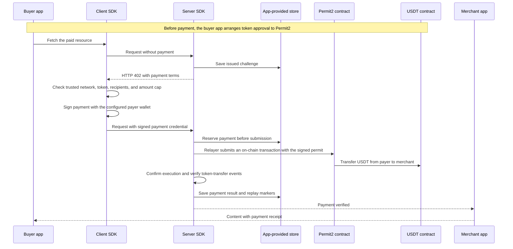
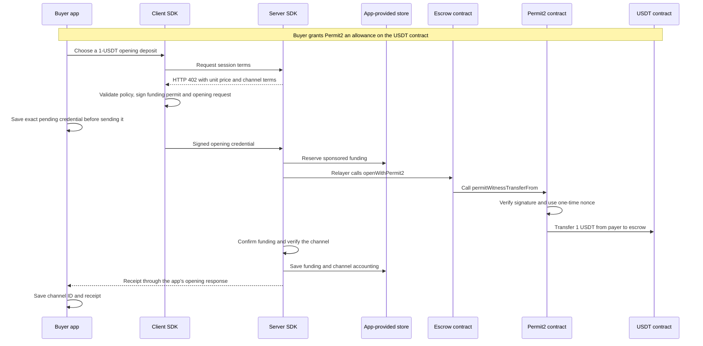
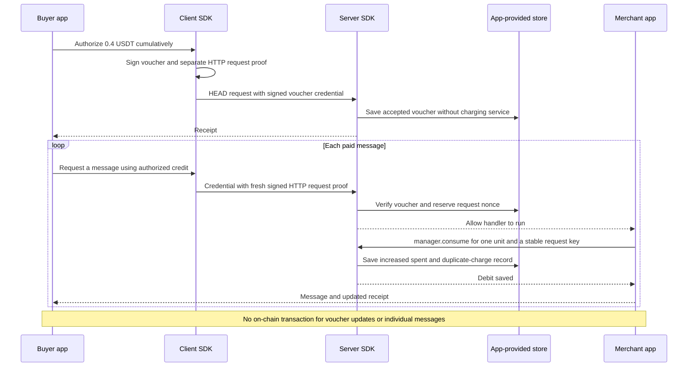
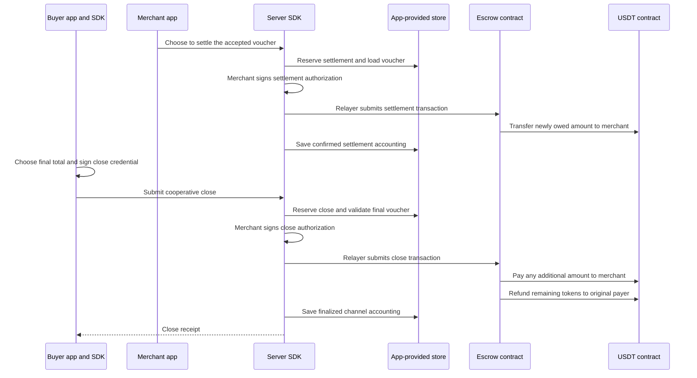

# @trondao/tron-mpp-sdk

Accept TRON **TRC-20 token payments with Permit2** through the Machine Payments Protocol (MPP). Payers sign typed payment authorizations, and a relayer submits sponsored transactions on-chain. The SDK supports two payment flows, called intents:

- **Charge:** collect one payment for one request, such as buying an article.
- **Session:** deposit tokens into escrow, then authorize payments for repeated use, such as API requests or streamed messages.

The SDK handles payment rules and verification. Your app chooses what to sell, sets prices, connects wallets and storage, and delivers the product or service. Smart contracts move or hold the tokens.

| Question | Charge | Session |
| --- | --- | --- |
| Where does Permit2 send the payer's tokens? | Directly to the merchant and any split recipients | Into the session escrow |
| Is there an on-chain transaction for each paid request? | Yes | Vouchers and usage charges are off-chain. Funding, settlement, and close are on-chain. |
| When does the merchant receive tokens? | When the payment is confirmed | When an authorized amount is settled or the channel closes |
| Main public method | `tron.charge(...)` | `tron.session(...)` |

## Install and connect to TRON

```sh
npm install @trondao/tron-mpp-sdk mppx viem
# Also install TronWeb if using the SDK's provided TRON integration.
npm install tronweb@^6.5.2
```

For Node.js integrations using TronWeb, use a release supported by TronWeb 6.5.2 (`^22.23.4`, `^24.22.1`, or `>=26.12.1`).

The package provides these entry points:

| Import | Purpose |
| --- | --- |
| `@trondao/tron-mpp-sdk` | Shared schemas, address helpers, chain IDs, signature helpers, and errors |
| `@trondao/tron-mpp-sdk/client` | Client payment methods and the Mppx HTTP client |
| `@trondao/tron-mpp-sdk/server` | Server payment methods, receipts, storage helpers, and session management |
| `@trondao/tron-mpp-sdk/tronweb` | Connect the payment methods to TronWeb wallets and nodes |
| `@trondao/tron-mpp-sdk/session` | Node.js session helpers that select the embedded escrow for the transport's chain |

### Amounts, wallets, and networks

- **Amounts are integer strings in token atomic units.** For a token with six decimals, `'1000000'` means 1 token and `'100000'` means 0.1 token. Your app must know the token's decimals and format prices for users.
- **The currency is a TRC-20 contract address.** Native TRX payments are unsupported. Wallets may still spend TRX or use Energy and Bandwidth for on-chain transactions.
- **The payer** owns the tokens. **The merchant/payee** receives payment. **The relayer** submits sponsored transactions and covers their network costs. The merchant and relayer can use different wallets.
- **A private key is not an address.** When an app configures a private key, the corresponding wallet signs. Your app owns key management and access control.
- Addresses can be Base58Check (`T...`), `41`-prefixed hex, or 20-byte `0x` hex. The SDK compares the underlying account values. Use `toBase58Address` when displaying an address.

Your app configures `fullHost` on the TronWeb instance and passes the matching numeric `chainId` to `createTronWebTransport`. Use the same network for payer, merchant and relayer connections.

| Network | TronWeb `fullHost` (TronGrid) | SDK `chainId` | SDK build `.env` key for Session |
| --- | --- | --- | --- |
| Nile testnet | `https://nile.trongrid.io` | `chains.nile` (`3448148188`) | `TRON_SESSION_ESCROW_ADDRESS_NILE` |
| Mainnet | `https://api.trongrid.io` | `chains.mainnet` (`728126428`) | `TRON_SESSION_ESCROW_ADDRESS_MAINNET` |

For example, configure a Nile payer transport as follows. To switch to Mainnet, change both values to the Mainnet pair above and use that network's token and Permit2 contracts.

```ts
import { TronWeb } from 'tronweb'
import { chains } from '@trondao/tron-mpp-sdk'
import { createTronWebTransport } from '@trondao/tron-mpp-sdk/tronweb'

const walletTronWeb = new TronWeb({
  fullHost: 'https://nile.trongrid.io',
  privateKey: process.env.TRON_PAYER_PRIVATE_KEY!,
})
const payerTransport = createTronWebTransport(walletTronWeb, {
  chainId: chains.nile,
})
```

Charges and explicitly configured session adapters support both networks. The configured session helpers use the deployments embedded in the build. The example release configuration embeds Nile only. If your app reads `TRON_FULL_HOST` from its environment, pair that endpoint with the matching chain ID. The endpoint determines where reads and transactions go. The configured chain ID is used in payment challenges, typed-data signing, and escrow selection. The transport trusts the chain ID you pass. At startup, check the endpoint's [`eth_chainId`](https://developers.tron.network/reference/eth_chainid) and reject a mismatch before enabling payments. Expect `0xcd8690dc` for Nile or `0x2b6653dc` for Mainnet.

## Credential Types

Set `credentialTypes: ['permit2']` on the charge server, charge client, and session server. For a session client, return a plan with `type: 'permit2'` from `preparePayment` when opening or topping up a channel.

| Flow | What the payer signs | Permit2 spender |
| --- | --- | --- |
| Charge | A permit for the payment terms in the HTTP 402 challenge | The relayer's address with the built-in adapter |
| Session funding | A permit tied to the channel being opened or topped up | The escrow contract |

In both flows, the payer grants a token allowance to the Permit2 contract before signing a permit. The relayer pays to submit the signed credential on-chain. The payer signs session vouchers separately, and settlement pays the merchant from escrow.

Charges advertise `transaction` by default. To use `hash` charges, enable `hash` in `credentialTypes` on both sides and provide the server's `authorizeHash` callback. Authenticate the caller and check that the submitted hash belongs to the order before returning the expected payer address. See the [charge integration guide](docs/PROTOCOL.md#charge-client).

## Charge: one payment for one request

For example, Alice pays 1 USDT to read an article from Bob's API. With Permit2, Alice signs permission to pay and Bob's relayer submits the payment. USDT moves **from Alice directly to Bob**. There is no session escrow.

### Charge sequence with Permit2

The SDK runs inside the client app and merchant server. In this diagram, the client SDK includes Mppx's HTTP handling, and the server SDK includes Mppx's challenge and receipt handling.



### What the SDK does for charge

- Creates and verifies payment terms sent as an HTTP 402 challenge.
- Checks the client's trusted chain IDs, tokens, recipients, Permit2 contract, spender, and price cap before signing. Every split recipient must also be trusted.
- Uses the configured payer wallet to sign the Permit2 credential.
- Checks signatures and payment details, submits the relayer's transaction, waits for confirmation, and verifies token transfer events.
- Uses the supplied atomic store to record issued challenges, pending submissions, confirmed results, and duplicate-payment markers. An atomic update means concurrent requests cannot both claim the same payment.
- Returns a payment receipt after verification and offers recovery for known pending submissions.

### What your app must do for charge

- Choose the token, amount, merchant, network, and any payment splits.
- Provide a payer wallet with enough tokens and a relayer wallet with enough resources to submit the transaction.
- Configure the locally trusted Permit2 address and spender. With the provided adapter, the charge spender must be the relayer's address.
- Arrange the payer's token approval before a Permit2 payment. The SDK does not silently grant unlimited token approval.
- Supply storage that survives restarts when payment records must survive restarts. Multiple server processes need a shared store with atomic updates.
- Mount the paid route and return content only after the SDK verifies payment.
- Decide how orders, invoices, content delivery, and customer retries work. Payment recovery does not automatically deliver or cache your product.

### Charge server example

These are integration snippets, not a complete server. The app supplies the wallet connections, token and wallet addresses, HTTP routing, server secret, and storage connection used below. `redisWithAtomicUpdate` represents a Redis connection implementing the atomic operations required by `Store.redis`; see the [integration guide](docs/PROTOCOL.md).

```ts
import { Mppx, Store, tron } from '@trondao/tron-mpp-sdk/server'
import { chains } from '@trondao/tron-mpp-sdk'
import { createChargeAdapter, createTronWebTransport } from '@trondao/tron-mpp-sdk/tronweb'

const adapter = createChargeAdapter(
  createTronWebTransport(relayerTronWeb, { chainId: chains.nile }),
  { minConfirmations: 1 },
)
const chargeMethod = tron.charge({
  adapter,
  chainId: chains.nile,
  currency: tokenAddress,
  recipient: merchantAddress,
  credentialTypes: ['permit2'],
  permit2: { address: permit2Address, spender: relayerAddress },
  store: Store.redis(redisWithAtomicUpdate),
})
const payment = Mppx.create({
  secretKey: process.env.MPP_SECRET_KEY!,
  methods: [chargeMethod],
})
const paid = payment.charge({ amount: '1000000', externalId: 'invoice-42' })

export async function handler(request: Request) {
  const result = await paid(request)
  if (result.status === 402) return result.challenge
  return result.withReceipt(Response.json({ article: 'Paid content' }))
}
```

The SDK verifies the 1-USDT payment, assuming a six-decimal token. Your app supplies the article and connects `handler` to its HTTP framework. `externalId` is an app-chosen reference such as an invoice ID.

### Charge client example

```ts
import { Mppx, tron } from '@trondao/tron-mpp-sdk/client'
import { chains } from '@trondao/tron-mpp-sdk'
import { createChargeAdapter, createTronWebTransport } from '@trondao/tron-mpp-sdk/tronweb'

const adapter = createChargeAdapter(
  createTronWebTransport(walletTronWeb, { chainId: chains.nile }),
)
const { fetch } = Mppx.create({
  polyfill: false,
  methods: [tron.charge({
    adapter,
    chainIds: [chains.nile],
    currencies: [tokenAddress],
    recipients: [merchantAddress], // Also include every expected split recipient.
    maxAtomicAmount: '1000000',
    credentialTypes: ['permit2'],
    permit2: { address: permit2Address, spender: relayerAddress },
  })],
})
const response = await fetch('https://merchant.example/article')
```

The client handles the 402 challenge and sends the payment credential. Your app configures spending policy and uses the returned content. Each new successful charge payment spends tokens again.

### Permit2 payment splits

Set `methodDetails.splits` on the paid route and include every split recipient in the client's trusted recipients list. Set split amounts in token atomic units. The primary recipient receives the total charge minus the splits. See the [protocol guide](docs/PROTOCOL.md#charge-server) for the complete route configuration.

### Charge recovery

If submission times out, your app must check the original payment before creating another payment:

- Call `chargeMethod.reconcile(challengeId)` to check a saved transaction hash and recover the receipt. This call only checks payment status and leaves content delivery to your app.
- Retrying the same pending credential can check the saved transaction hash without rebroadcasting. The server rejects replay of a completed charge credential with HTTP 402.
- If the store has a pending record but no transaction hash, investigate the relayer's wallet and retain the record until you know the outcome.

## Session: fund once, authorize ongoing use

For example, Alice deposits 1 USDT into escrow to buy messages from Bob at 0.1 USDT each. Alice signs **vouchers** and Bob records usage off-chain. On-chain transactions fund the channel, pay Bob from escrow, and refund any unsettled remainder to Alice when the channel closes.

A voucher is a signed authorization for a **cumulative total**. A voucher for 0.4 USDT followed by one for 0.8 USDT raises the authorized total to 0.8 USDT. The merchant can settle the full accepted voucher before the payer uses all the corresponding service credit.

### Session terms in plain language

| Term | Meaning |
| --- | --- |
| Channel | One payer/merchant agreement backed by tokens in escrow |
| Deposit | Total tokens funded into the channel; this total does not shrink when settlement pays the merchant |
| Voucher / `acceptedCumulative` | The highest cumulative amount authorized by an accepted spending voucher |
| `spent` | Total price of service the app has charged through the SDK's accounting |
| `settledOnChain` | Total tokens already paid from escrow to the merchant, as recorded by the server |
| Top-up | Additional tokens moved from payer to escrow; it does not itself increase the voucher limit |
| Settlement | Pay an authorized amount from escrow while keeping the channel open |
| Cooperative close | Finalize the channel with payer/merchant cooperation, pay any further amount owed, and refund the remainder |
| Forced close | Payer starts a waiting period, then withdraws the unsettled remainder without needing merchant cooperation |

Available service credit is `min(acceptedCumulative, deposit) - spent`. Remaining tokens in escrow are a different amount: deposit minus tokens already settled.

### Session opening sequence with Permit2

This diagram uses sponsored funding and an app-controlled opening with no service charge. The app selects this behavior with `chargeOnVerify: false` and handles the opening response itself. Default automatic billing is explained below.



The session funding transaction targets **escrow**, which then calls **Permit2**. For a charge, the relayer's transaction targets Permit2 directly. Permit2 instructs the token contract to transfer funds directly from the payer to the recipients or to escrow.

### Session voucher and service sequence

This diagram uses app-controlled metering. A message can instead be an API request, generated token, byte, or another unit your app defines.



The credential's `requestAuthorization` proof binds it to the HTTP challenge and payload. A voucher published during settlement cannot be reused on its own to obtain someone else's service. Replaying a successful service credential returns HTTP 409. A new signed request is a new service attempt, subject to available credit. Repeating the same voucher update through `HEAD` does not charge a unit.

### Session settlement and close sequence



This shows `createConfiguredSession(...).serverAdapter(payeeSigner)`, where the merchant signs off-chain and a relayer submits the settlement and close transactions. Permit2 funds the channel. Settlement and refunds use the tokens held by escrow.

### What the SDK does for sessions

- Checks trusted channel terms, token, chain, merchant, unit-price cap, and cumulative spending cap before the configured wallet signs or funds a payment plan.
- Uses the wallet to sign vouchers, funding permits, and separate HTTP request proofs. Custom wallets must implement `signRequest` as well as payment signing.
- With the configured helpers, resolves the embedded escrow, builds sponsored funding calls, and confirms the expected channel and deposit events.
- Verifies vouchers and request proofs, rejects reused service credentials, and updates accounting through the app-provided atomic store.
- Debits a service unit automatically by default, or debits explicit usage when the app calls `manager.consume`.
- Provides settlement, close, reconciliation, receipt, and stream-event helpers. It enforces payment rules when the app calls these operations; it does not decide when your business should invoke them.

### What your app must do for sessions

- Arrange a compatible escrow deployment, its token allowlist, Permit2 address, and network. The SDK does not deploy contracts. Supported tokens must transfer the exact amount and must not rebase balances.
- Set the service price and unit, payer spending limits, deposit and top-up amounts, trusted merchant, and network.
- Provide the merchant's wallet to sign settlement and close authorizations. The relayer can use a separate wallet to submit those transactions and cover the network costs.
- Arrange token approval when funding requires it. The escrow is the Permit2 spender for sessions; the payer's token allowance is still granted to Permit2.
- Implement `preparePayment` to return unsigned instructions: open, update a voucher, top up, merge funding with a voucher, or close. Choose amounts from local policy and saved state. Do not sign, approve, or broadcast inside that callback; the SDK checks the plan before wallet execution.
- Supply shared persistent storage with atomic updates for server accounting. Save client channel IDs, receipts, exact pending credentials, and known transaction hashes for recovery.
- Build the HTTP routes and service responses. Choose automatic billing or explicit metering, and persist each manual debit before delivering that unit.
- Decide when to ask for a higher voucher, accept more deposits, settle, close, reconcile, and prune old request records. Operator routes and their authentication belong to the app.
- Handle delivery failures and business retries. The SDK does not cache article/message bodies or guarantee that a saved debit reached the user's screen.

### Session deployment configuration

Deploy `TronPaymentChannel` from the separate [contract repository](../tron-mpp-sdk-contract/README.md), or use a compatible existing deployment on the intended network. Configure its token allowlist and Permit2 contract. Its close grace period must be at least 900 seconds.

**For SDK maintainers building a release:** set each deployed escrow in the SDK repository's `.env` before building. Rename the old `TRON_SESSION_ESCROW_ADDRESS` key to `TRON_SESSION_ESCROW_ADDRESS_NILE` if it contains your Nile deployment.

```dotenv
TRON_SESSION_ESCROW_ADDRESS_NILE=<deployed Nile escrow address>
TRON_SESSION_ESCROW_ADDRESS_MAINNET=<deployed Mainnet escrow address>
```

```sh
npm run build
```

If a network has no deployment, leave nothing after its `=`. The build requires at least one address, validates every supplied address, and embeds the public addresses by chain ID. Invalid or zero addresses fail the build. `npm pack` and `npm publish` also run this build through `prepack`. The package excludes `.env` files.

**For apps using a built package:** pass the transport, token (`currency`), and Permit2 address to `createConfiguredSession` from `@trondao/tron-mpp-sdk/session`. The helper uses `transport.chainId` to select the address embedded for that chain. If the build has no escrow for that chain, session creation throws. The app needs no escrow environment variables. Rebuild the SDK and restart the app after changing an embedded address. Updating an address in a published package requires a new SDK release.

Call `session.inspect()` before using the configured deployment. It checks the escrow's Permit2 address, token allowlist, grace period, and both signing domains against the configured chain ID. It does not independently prove the RPC node's network. Lower-level APIs accepting an explicit escrow remain available for existing integrations.

### Session server example

The app supplies `relayerTronWeb`, `merchantTronWeb`, `tokenAddress`, `merchantAddress`, `permit2Address`, and `redisWithAtomicUpdate`. The merchant wallet must match `merchantAddress`. This example uses automatic one-unit billing; app-controlled opening and streaming require the explicit metering mode described next.

```ts
import { Mppx, Store, tron } from '@trondao/tron-mpp-sdk/server'
import { chains } from '@trondao/tron-mpp-sdk'
import { createTronWebTransport } from '@trondao/tron-mpp-sdk/tronweb'
import { createConfiguredSession } from '@trondao/tron-mpp-sdk/session'

const relayerTransport = createTronWebTransport(relayerTronWeb, {
  chainId: chains.nile,
})
const merchantTransport = createTronWebTransport(merchantTronWeb, {
  chainId: chains.nile,
})
const session = createConfiguredSession(relayerTransport, {
  currency: tokenAddress,
  permit2Contract: permit2Address,
})
await session.inspect()

const sessionMethod = tron.session({
  adapter: session.serverAdapter(merchantTransport.signTypedData!),
  currency: tokenAddress,
  recipient: merchantAddress,
  credentialTypes: ['permit2'],
  permit2Contract: permit2Address,
  store: Store.redis(redisWithAtomicUpdate),
})
const payment = Mppx.create({
  secretKey: process.env.MPP_SECRET_KEY!,
  methods: [sessionMethod],
})
const paid = payment.session({
  amount: '100000', // 0.1 USDT per unit for a six-decimal token.
  unitType: 'message',
  suggestedDeposit: '1000000',
})

export async function handler(request: Request) {
  const result = await paid(request)
  if (result.status === 402) return result.challenge
  return result.withReceipt(Response.json({ message: 'Paid message' }))
}
```

Mppx handles management responses such as `HEAD` voucher updates, top-ups, and close without running the paid-content handler. Your framework must forward its response and receipt. See the [integration guide](docs/PROTOCOL.md) for the full HTTP behavior.

### What the configured session helper provides

`createConfiguredSession(transport, options)` returns helpers bound to the same embedded escrow:

| Helper | Use it to |
| --- | --- |
| `session.inspect()` | Read and check the deployed contracts before use |
| `session.metadata` | Display the configured chain ID and escrow address |
| `session.wallet` | Sign and execute session payment plans with the supplied payer transport |
| `session.client(...)` | Create the client method with the embedded escrow and transport chain ID already selected |
| `session.assertRequest(request)` | Reject a challenge with a different chain ID or escrow |
| `session.computeChannelId(...)` | Calculate the channel ID from its participants, token, salt, signer, chain, and escrow |
| `session.serverAdapter(payeeSigner)` | Use the merchant's authorization signatures to relay settlement and close transactions |
| `session.approve(amount, hooks)` | Explicitly approve Permit2 on the configured token contract |
| `session.force(action, channelId, hooks)` | Submit payer forced-close or withdrawal operations |
| `session.stateBinding(...)` | Identify which deployment and wallets a saved client state belongs to |

For tooling, `getSessionEscrowAddress(chainId)` from `@trondao/tron-mpp-sdk/config` returns the embedded address for that chain. Pass `chains.nile` or `chains.mainnet` explicitly. The legacy no-argument call selects Nile. App session flows should use the configured session helper so signing, policy, and transaction targets use the same deployment.

### Session client example

The app supplies `payerTransport`, token, Permit2, merchant and payer addresses, and a `choosePaymentPlan` callback implementing `preparePayment`. For Permit2 funding plans, the `authorization` field holds the unsigned permit data. On open, use `session.computeChannelId(...)` with the same payer, payee, salt, and optional authorized signer as the plan. The SDK validates the plan before signing. See the [integration guide](docs/PROTOCOL.md#sessions) for funding details.

```ts
import { Mppx } from '@trondao/tron-mpp-sdk/client'
import { createConfiguredSession } from '@trondao/tron-mpp-sdk/session'

const session = createConfiguredSession(payerTransport, {
  currency: tokenAddress,
  permit2Contract: permit2Address,
})
await session.inspect()

const method = session.client({
  recipients: [merchantAddress],
  payer: payerAddress,
  maxUnitAmount: '100000',
  maxCumulativeAmount: '2000000',
  preparePayment: choosePaymentPlan, // App returns an unsigned payment plan.
})
const client = Mppx.create({ polyfill: false, methods: [method] })
```

Your app chooses the action and amount in `choosePaymentPlan` and saves the resulting channel ID and pending credential before submitting a request. A standalone voucher update uses `HEAD`; a paid request uses the route and method your app defines. Creating a new credential is not a recovery strategy for an unresolved payment.

`createConfiguredSession` is a **Node.js entry point**. The separate protocol and client entry points remain browser-compatible; browser apps need an appropriate wallet integration rather than importing the Node.js helper.

### Automatic billing versus app-controlled metering

- **Automatic billing (default):** a successful open/voucher service request consumes one unit before your handler runs. The opening voucher must cover that first unit. `HEAD` voucher updates, top-ups, and close are management operations and do not charge a service unit.
- **App-controlled metering:** set `chargeOnVerify: false` on `tron.session`. The SDK still authenticates the request and prevents service-credential replay, but your app decides how many units to charge. Call `sessionMethod.manager.consume(requestTerms, channelId, units, stableRequestKey)` before delivering each unit. The `requestTerms` are the verified session request terms, and the stable key identifies that particular debit. Opening can then be a management-only response with a zero-value initial voucher, as in the opening diagram.
- **Streaming:** your app creates the stream, records each debit before sending a chunk, stops when credit is insufficient, and sends a final receipt with the updated totals. SDK helpers `needVoucherEvent` and `receiptEvent` format the payment events. `result.withReceipt(streamingResponse)` preserves the stream, but its initial receipt does not describe later usage; emit the final updated receipt too.

A stream is a way to deliver content progressively, not a required unit of payment. `SESSION_STREAM_UNITS` and commands such as `npm run session:pay` belong to the separate test app, not to this SDK's public API.

### Session transactions and network costs

These are SDK operations or payment-plan actions; your app chooses command names and HTTP routes.

| Action | Token or contract effect | Who pays on-chain costs? |
| --- | --- | --- |
| Explicit `session.approve(amount)` | Calls the token contract to approve Permit2; no tokens move | Payer transport |
| Open with Permit2 | Payer tokens go directly into escrow through Permit2 | Relayer |
| Top-up or voucher merged with Permit2 funding | More payer tokens go directly into escrow | Relayer |
| Voucher update, paid message, or streamed unit | Uses off-chain signatures and stored accounting | No on-chain transaction |
| `sessionMethod.manager.settle(channelId)` | Escrow pays accepted cumulative voucher amount minus what was already settled | Relayer in the configured server example |
| Cooperative close | Escrow pays any additional agreed amount and refunds the remainder | Relayer in the configured server example |
| `session.force('requestClose', channelId)` | Starts the payer's waiting period; no refund yet | Payer transport |
| `session.force('withdraw', channelId)` | After the waiting period, refunds the unsettled remainder to the original payer | Payer transport |
| `sessionMethod.manager.reconcile(channelId)` | Checks an existing submission and may update stored accounting | No new on-chain transaction |

Use a payer transport for approval and forced recovery, and the configured relayer transport for sponsored server transactions. Call `session.approve(amount)` when the payer needs to set an allowance, or pass `'0'` to revoke it. The helper sends a token approval transaction even if the allowance is already set to that amount. Successful Permit2 funding consumes a one-time nonce. The token contract tracks the allowance separately.

### Session accounting example

With a six-decimal token:

1. Alice deposits **1 USDT**. Escrow holds it; Bob has received no tokens yet.
2. Alice signs a voucher for **0.4 USDT cumulatively**. No tokens move.
3. The app delivers three 0.1-USDT messages and records **`spent = 0.3 USDT`**.
4. If Bob settles the accepted voucher, escrow pays him **0.4 USDT**, including 0.1 USDT of unused prepaid service credit. That remaining service credit can still be consumed while the channel is open.
5. Closing cannot refund an amount already settled. If the channel closes at 0.4 USDT, Alice receives **0.6 USDT back**.

The app chooses the final close amount and obtains the payer's signature. The SDK rejects a close voucher below recorded service spending, and the contract enforces what has already been settled. The test app chooses the greater of recorded spending and previous settlement; this choice is app policy, not an automatic refund rule for every SDK integration.

### Where session records live

**Your app supplies storage; the SDK supplies the payment-accounting logic.** The SDK does not automatically create `.data/session/server.json` or `client.json`.

- **On-chain:** channel funding, settled totals, forced-close requests, and finalization. Token contracts record balances and transfers. Individual usage debits are tracked off-chain.
- **Server store supplied by the app:** accepted vouchers, `spent`, observed deposit and settlement totals, used request IDs, and pending funding, settlement, or close records with known transaction hashes. The SDK reads and updates these through `Store.AtomicStore`.
- **Client storage supplied by the app:** channel ID, deployment binding, exact pending signed credentials, any known transaction hashes, and the latest receipt. The app decides when and how to save these.
- **Product records supplied by the app:** orders, message bodies, delivery results, business idempotency keys, and any response cache.

The local test app uses JSON journals in `.data/session`. Those filenames and its `jq` inspection commands are app features. A production deployment needs a store appropriate for its process and recovery model. `Store.memory()` loses records on restart and is suitable only where that loss is acceptable, such as disposable tests. Multiple workers need a shared atomic store.

### Session recovery and record cleanup

- For wallet-funded opens and top-ups, provide an atomic `fundingStore` to `createSessionWallet` or `createConfiguredSession` to retain pending funding across restarts. On `SessionFundingPendingError`, retain its `channelId` and any `hash`. Retry the same funding plan with an active challenge and the same store. The wallet checks the saved submission before creating the credential. Once it returns a credential, save and reuse it if the HTTP submission fails.
- Call `sessionMethod.manager.reconcile(channelId)` after an uncertain settlement or close. For saved sponsored funding, use `manager.reconcileFunding(request, channelId, funding)` with the original signed funding data. These calls check existing submissions without sending a new transaction or delivering content. Confirmed failures release the operation so the app can choose to retry. Unknown results remain pending.
- Retain the exact signed funding authorization and known transaction hash. The server can verify a saved funding transaction even after the permit expires. If the server never recorded a hash, investigate the relayer's wallet.
- A service debit is persisted before delivery. If delivery fails afterward, the app must reconcile the service result or recover its cached response. A new signed request is a new service attempt; an `Idempotency-Key` header alone does not bypass billing.
- For payer recovery, request forced close, wait until the on-chain close timestamp plus the contract's grace period, then withdraw the unsettled remainder. The merchant may settle during the waiting period. The built-in adapter cannot automatically confirm external forced withdrawal in server accounting; that needs a custom `confirmedChannel` adapter at the required confirmation depth.
- Keep a deployment binding with saved client state: `session.stateBinding({ serverUrl, recipient, payer })`. Reject saved state when it no longer matches the configured wallets, token, network, and escrow.
- For explicit approval and forced recovery, use `beforeSubmit` to save a pending reservation after simulation and `onSubmitted(hash)` to save the transaction hash before waiting for confirmation. If the outcome is uncertain, retain those records and check the original transaction before retrying.
- Request records are capped by `maxIdempotencyRecords` (default **10,000 per channel**). At the limit, new records fail before charging. Once the channel is closed and `requestRetentionMs` has elapsed (default **24 hours**), schedule `manager.pruneRequests(channelId)` to remove expired records in batches. Active records are retained; the closed-channel marker remains so cleanup cannot reopen the channel.

## Challenge lifetime and storage limits

Issued HTTP challenges need a finite future expiry. Mppx defaults to five minutes. The SDK saves the exact issued challenge so altered terms cannot be accepted later.

The challenge store uses 256 bounded groups, each holding at most `maxIssuedChallengesPerBucket` live challenges (default 64). Expired entries are removed when a group is accessed. A full group returns HTTP 503 without issuing another challenge; existing challenges remain valid. See the [protocol guide](docs/PROTOCOL.md) before upgrading a store using an older challenge format.

## Build and validate this repository

Use the SDK `.env` deployment configuration described above before building locally:

```sh
npm run check
npm test
npm run build
npm run test:package
```

- `check` checks TypeScript.
- `test` runs the automated SDK tests with deterministic escrow addresses. The source tests do not need the SDK `.env`.
- `build` reads the SDK `.env`, validates the escrow addresses, and builds the package.
- `test:package` packs and extracts the real package, checks that `.env` files are excluded, and checks escrow selection in installed and bundled consumers with conflicting runtime environment variables. It makes no chain calls.

Changing the SDK code or embedded escrow requires rebuilding and restarting apps using that build. Contract tests and TRON compilation live in the separate [contract repository](../tron-mpp-sdk-contract/README.md).

## More detail

- [Protocol and integration guide](docs/PROTOCOL.md): full request formats, payment plans, HTTP behavior, storage, migration, and recovery.
- [End-to-end implementation map](docs/END_TO_END_FLOW.md): how protocol, client, server, transport, and contracts fit together.
- [Contract repository](../tron-mpp-sdk-contract/README.md): escrow implementation and deployment requirements.
- [Local test app](../tron-mpp-sdk-app-test/README.md): command-by-command Nile charge and session walkthroughs, wallet impacts, and JSON-journal inspection.
