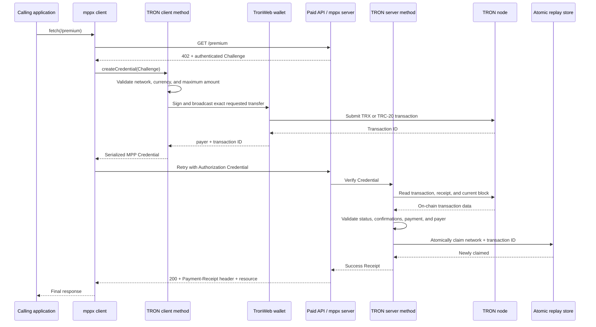

# TRON MPP SDK: end-to-end architecture

This document explains how `tron-mpp-sdk` participates in a complete paid HTTP
request, from server configuration through the final MPP Receipt. It describes
the current `charge` intent for native TRX and TRC-20 transfers.

## The entry points

There is no single runtime entry point because a payment method has shared,
client, server, and optional wallet-adapter responsibilities. The npm package
exposes four entry points:

| Import path | Source entry point | Responsibility |
| --- | --- | --- |
| `tron-mpp-sdk` | `src/index.ts` | Shared method definition, schemas, and types |
| `tron-mpp-sdk/client` | `src/client/index.ts` | Client payment policy and Credential creation |
| `tron-mpp-sdk/server` | `src/server/index.ts` | Challenge defaults, verification, replay protection, and Receipts |
| `tron-mpp-sdk/tronweb` | `src/tronweb/index.ts` | Optional TronWeb signer and verifier adapters |

For an application, the practical entry points are:

```ts
// Paying application
import { Mppx, tron } from 'tron-mpp-sdk/client'

// Paid API
import { Mppx, tron } from 'tron-mpp-sdk/server'

// Either side, when using TronWeb
import {
  createTronWebSigner,
  createTronWebVerifier,
} from 'tron-mpp-sdk/tronweb'
```

`tron(...)` is a convenience alias for `tron.charge(...)`. The package currently
implements only the `charge` intent.

## Responsibility boundaries

Four components collaborate during a payment:

| Component | Owns |
| --- | --- |
| Application | HTTP route, price, recipient, secrets, wallet/node configuration, and persistent store infrastructure |
| `mppx` | HTTP 402 flow, authenticated Challenge, Credential serialization, retries, verification lifecycle, and Receipt transport |
| `tron-mpp-sdk` | TRON schemas, payment policy, signer/verifier contracts, transaction validation, replay protection, and TRON Receipt data |
| TronWeb/TRON node | Transaction construction, signing, broadcasting, chain queries, address conversion, and confirmation data |

The SDK never reads `MPP_SECRET_KEY`. The server application supplies that
secret to `Mppx.create()`, and `mppx` uses it to authenticate Challenges. The
SDK also never needs a server private key: the receiving server only queries the
chain. A payer private key belongs exclusively to the client wallet.

## Complete request sequence



## 1. Shared method definition

`src/Methods.ts` defines the method once with `Method.from()`:

```ts
Method.from({
  name: 'tron',
  intent: 'charge',
  schema: {
    request: /* TRON charge schema and normalization */,
    credential: { payload: /* transaction proof schema */ },
  },
})
```

Both client and server wrappers extend this same definition. This guarantees
that both sides agree on method name, intent, request format, and Credential
payload.

### Input amount versus wire amount

An API author supplies a display-unit amount:

```ts
payment.charge({ amount: '1.25' })
```

The shared request transform uses viem's decimal-safe `parseUnits` utility. For
TRX, which defaults to six decimals:

```text
1.25 TRX -> 1250000 sun
```

The Challenge carries the atomic string `"1250000"`. No JavaScript floating
point arithmetic is used for money.

### Normalized Challenge request

A native TRX request has this logical shape:

```json
{
  "amount": "1250000",
  "currency": "TRX",
  "recipient": "T...",
  "description": "Premium endpoint",
  "methodDetails": {
    "network": "nile",
    "asset": {
      "type": "native",
      "symbol": "TRX",
      "decimals": 6
    },
    "minConfirmations": 1
  }
}
```

For TRC-20, `asset` additionally includes `contractAddress`, and the default
`currency` is that contract address rather than the token symbol.

## 2. Server method initialization

The API registers the TRON server method once:

```ts
const payment = Mppx.create({
  secretKey: process.env.MPP_SECRET_KEY,
  methods: [
    tron({
      verifier: createTronWebVerifier(tronWeb),
      network: 'nile',
      recipient: 'T...',
      asset: { type: 'native', symbol: 'TRX', decimals: 6 },
      minConfirmations: 1,
      store: replayStore,
    }),
  ],
})
```

`src/server/Charge.ts` turns the shared method into a server method with
`Method.toServer()`. Its configuration provides route defaults so callers do
not repeat the network, recipient, and asset for every endpoint.

The server method also defines a stable binding containing:

- atomic amount;
- currency;
- recipient; and
- all TRON-specific `methodDetails`.

These fields are part of the authenticated Challenge terms. The client cannot
change them when returning the Credential without invalidating the Challenge.

## 3. Initial request and HTTP 402 Challenge

When a caller requests a protected route without a Credential, `mppx` creates a
Challenge and returns HTTP `402 Payment Required`. The Challenge identifies:

- method: `tron`;
- intent: `charge`;
- server realm;
- unique authenticated Challenge ID; and
- normalized request terms.

`MPP_SECRET_KEY` is used by `mppx`, not by this SDK, to create and verify the
HMAC-bound Challenge ID. This lets the server detect a forged or modified
Challenge without placing the full Challenge in server-side storage.

## 4. Client method and payment policy

The paying application registers the client method:

```ts
const method = tron({
  signer: createTronWebSigner(tronWeb),
  networks: ['nile'],
  currencies: ['TRX'],
  maxAmount: '0.01',
})

const { fetch } = Mppx.create({
  methods: [method],
  polyfill: false,
})
```

After receiving the 402, `mppx` selects the matching `tron/charge` method and
calls `createCredential()` in `src/client/Charge.ts`.

Before touching the wallet, the client checks its local policy:

1. The requested network must be in `networks`, when configured.
2. The requested currency must be in `currencies`, when configured.
3. The atomic amount must not exceed `maxAtomicAmount`, when configured.
4. The display-unit amount must not exceed `maxAmount`, when configured.

These are payer protections. They do not replace server verification.

## 5. Signing and broadcasting

The client wrapper calls the configured `ChargeSigner`:

```ts
type ChargeSigner = (parameters: {
  challengeId: string
  request: ChargeRequest
}) => Promise<{
  type: 'transaction'
  payer: string
  txId: string
}>
```

The signer interface is intentionally independent of TronWeb. Applications may
integrate a browser wallet, hardware wallet, custody service, or another TRON
library. `createTronWebSigner()` is the included convenience implementation.

### Native TRX

The TronWeb adapter calls:

```ts
tronWeb.trx.sendTransaction(request.recipient, request.amount, options)
```

The amount is already in sun.

### TRC-20

The adapter resolves the configured token contract and calls:

```ts
contract.transfer(request.recipient, request.amount).send(options)
```

The amount is already in the token's atomic units.

The base signer returns after broadcast. If the server requires confirmations,
the application must account for inclusion timing. The end-to-end test app wraps
the signer and waits for a confirmed transaction before allowing `mppx` to retry.

## 6. Credential creation

After broadcast, the client builds this payload:

```json
{
  "type": "transaction",
  "payer": "T...",
  "txId": "64-character-hex-transaction-id"
}
```

It also creates a source identifier:

```text
did:pkh:tron:<network>:<payer-address>
```

For example:

```text
did:pkh:tron:nile:TLa2f6VPqDgRE67v1736s7bJ8Ray5wYjU7
```

`Credential.from()` associates the payload and source with the original
Challenge, and `Credential.serialize()` produces the value used in the retry's
HTTP `Authorization` header.

The Credential proves which transaction the server should inspect. The
transaction ID alone is not trusted as proof of correct payment.

## 7. Credential retry and core MPP validation

The MPP-aware client retries the original HTTP request with the serialized
Credential. Before invoking TRON verification, `mppx` validates the Credential
shape and authenticated Challenge binding.

`src/server/Charge.ts` then checks that the Credential source equals the source
derived from its payload payer and the requested network. It passes only the
transaction payload and the original Challenge request to the configured
`ChargeVerifier`.

## 8. TronWeb on-chain verification

`createTronWebVerifier()` queries the TRON node concurrently for:

- the transaction (`getTransaction`); and
- transaction information/receipt (`getTransactionInfo`).

It then performs the following checks.

### Transaction execution status

The verifier accepts only `SUCCESS`, read from:

- `transactionInfo.receipt.result`, when present; or
- `transaction.ret[0].contractRet`.

`transactionInfo.contractResult` is not a status. It contains contract return
data and may be `[""]` for a successful native transfer.

### Confirmations

When `minConfirmations` is greater than zero, the verifier requires:

- a transaction `blockNumber`;
- `tronWeb.trx.getCurrentBlock()` support; and
- `currentBlock - transactionBlock + 1 >= minConfirmations`.

### Native TRX verification

The first transaction contract must be `TransferContract`. The verifier reads:

- `amount`;
- `to_address`; and
- `owner_address`.

It converts hex addresses to base58 and requires exact matches for atomic amount
and recipient. The owner becomes the verified payer.

### TRC-20 verification

The first transaction contract must be `TriggerSmartContract`, and its contract
address must match the requested TRC-20 contract. The verifier then locates the
standard ERC-20/TRC-20 `Transfer(address,address,uint256)` event in the receipt
logs and validates:

- emitting token contract;
- recipient topic; and
- atomic transfer amount.

The event's `from` topic becomes the verified payer.

### Payer and reference binding

The TronWeb adapter requires the on-chain payer to equal the Credential payer.
The server wrapper additionally requires:

- verifier `reference === payload.txId`; and
- verifier `payer === payload.payer`.

This prevents a custom verifier from accidentally returning results for a
different transaction or payer.

## 9. Replay protection

After all verification succeeds, the server atomically claims:

```text
tron:charge:<network>:<lowercase-transaction-id>
```

The claim uses MPP's `Store.AtomicStore.update()` operation. The callback writes
the consumption timestamp only when the key does not already exist:

```text
missing key  -> store timestamp -> accept
existing key -> no write        -> reject
```

Atomic read-modify-write is essential. A separate `get()` followed by `put()`
would allow two concurrent requests to accept the same transaction.

If no store is supplied, the SDK creates `Store.memory()`. That is appropriate
for tests and a single long-running process, but it is cleared on restart and is
not shared between independently configured server instances. Production apps
must inject one shared persistent atomic store across all instances that accept
the same payments.

Reusing an accepted transaction produces `VerificationFailedError` with:

```text
TRON transaction has already been used
```

The HTTP transport converts the verification failure into a 402 Problem Details
response and may include a fresh Challenge so the client can make a new payment.

## 10. Receipt and protected response

After the atomic claim, the server method returns an MPP `Receipt`:

```json
{
  "method": "tron",
  "reference": "<transaction-id>",
  "status": "success",
  "timestamp": "<TRON block timestamp>"
}
```

The reference is the verified TRON transaction ID. When TronWeb supplies a block
timestamp, the SDK uses it; otherwise it uses the server's current time.

For Fetch API integrations, the application calls:

```ts
return result.withReceipt(Response.json({ data: '...' }))
```

For Node's native HTTP API, `Mppx.toNodeListener()` writes a 402 Challenge when
payment is absent or invalid. On success it attaches the serialized Receipt to
the `Payment-Receipt` header, and the application writes the protected body.

The payer-side `mppx.fetch()` returns only the final response to application
code. A successful end-to-end call therefore has HTTP 200, protected content,
and an optional auditable `Payment-Receipt` header.

## Why a failed verification can cause another payment

An MPP client interprets a 402 response as a request for payment. If a server
rejects a transaction and responds with another valid Challenge, an automatic
client may pay again up to its retry limit. This is why server verification must
be correct and why client `maxAmount`, network, and currency policies matter.

The end-to-end app waits for confirmation before retrying so a correctly
configured `minConfirmations: 1` server does not reject a transaction merely
because its receipt is not visible yet.

## Error categories

Common failures include:

| Stage | Example |
| --- | --- |
| Schema validation | Invalid address, transaction ID, or atomic amount |
| Client policy | Disallowed network/currency or amount over limit |
| Wallet | Missing payer, rejected signature, insufficient balance/resources |
| Status | Failed, reverted, or unavailable transaction result |
| Confirmation | Transaction not included or too few confirmations |
| Native transfer | Wrong contract type, amount, or recipient |
| TRC-20 transfer | Wrong token contract or missing/mismatched Transfer event |
| Identity binding | Credential source or payer mismatch |
| Reference binding | Verifier returned a different transaction ID |
| Replay | Network/transaction ID was already claimed |

No Receipt is issued for any failure.

## Source map

| File | Role in the flow |
| --- | --- |
| `src/Types.ts` | Constants, validation schemas, normalized request and signer/verifier contracts |
| `src/Methods.ts` | Shared `tron/charge` definition and display-to-atomic transform |
| `src/client/Charge.ts` | Client policy, signer invocation, source construction, and Credential serialization |
| `src/client/index.ts` | Client exports and `tron` namespace |
| `src/server/Charge.ts` | Defaults, stable binding, verifier orchestration, replay claim, and Receipt creation |
| `src/server/index.ts` | Server exports plus `Mppx`, `Expires`, and `Store` re-exports |
| `src/tronweb/index.ts` | TronWeb signer, chain verifier, confirmation logic, and TRX/TRC-20 parsing |
| `src/index.ts` | Shared schemas and method exports |
| `test/sdk.test.ts` | Deterministic unit coverage with fake signers, verifiers, and TRON node data |

## Current scope and production considerations

The current implementation supports one-time `charge` payments. It does not yet
implement MPP sessions or subscriptions.

Before production deployment:

1. Use a shared persistent atomic replay store.
2. Keep `MPP_SECRET_KEY` stable, secret, server-only, and managed through a
   secret manager.
3. Keep payer keys client-only and out of source control.
4. Use explicit network and currency allowlists plus a client maximum amount.
5. Require an appropriate number of confirmations for the risk level.
6. Use reliable authenticated TRON node infrastructure.
7. Test both successful and adversarial flows on Nile before mainnet.
8. Monitor Challenge creation, payment success, verification failures, and
   transaction references without logging private keys or bearer credentials.
9. Ensure automatic retries cannot exceed the application's intended spending
   policy.

## End-to-end test application

The companion app at `../tron-mpp-sdk-app-test` demonstrates the complete native
TRX path:

- `src/server.ts`: Node paid endpoint and TronWeb verifier;
- `src/payment-client.ts`: client method and confirmation-aware signer;
- `src/client.ts`: automatic 402/payment/retry flow; and
- `src/replay.ts`: one accepted Credential followed by an intentional replay.

Its successful output proves integration of the public SDK entry points, a real
Nile transaction, MPP Credential retry, on-chain verification, replay claiming,
Receipt transport, and protected-resource delivery.
